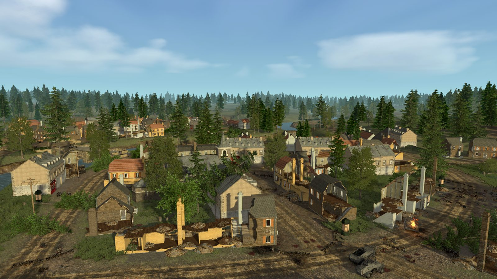
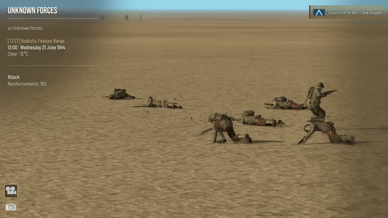
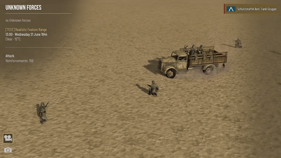
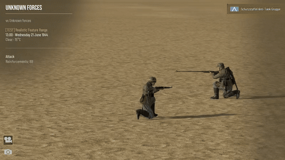
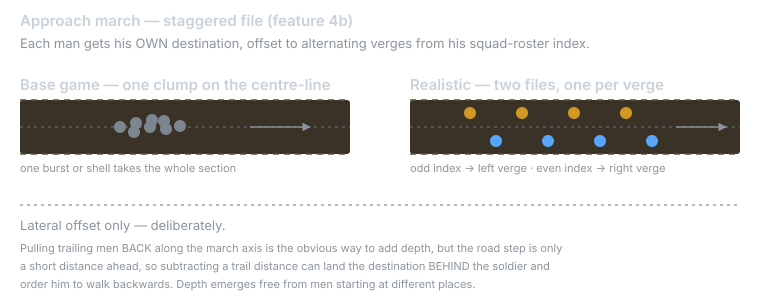
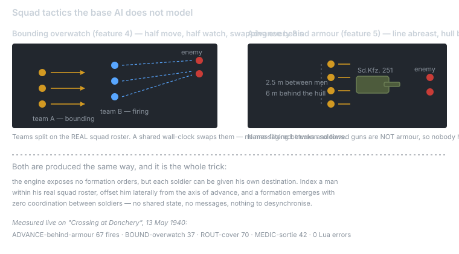
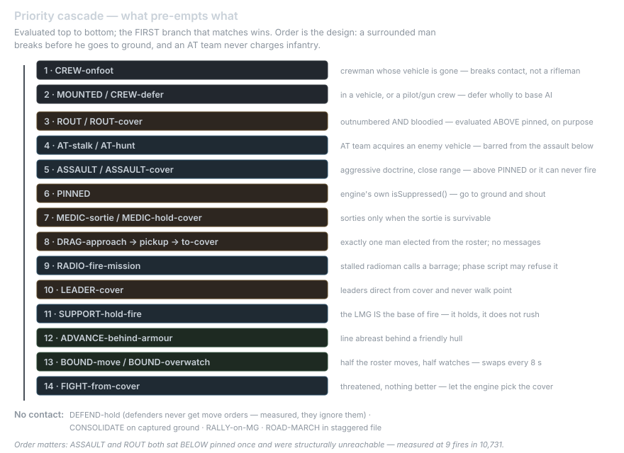

# Realistic — soldier AI for Easy Red 2

**Version 1.5.0 (prepared, not yet tagged — see [RELEASE-CHECKLIST.md](RELEASE-CHECKLIST.md)) · tested on game v2.1.0 · API reference verified on v2.0.9 · [CHANGELOG](CHANGELOG.md)**

Per-soldier WW2 infantry behaviour for **Easy Red 2**. Two Lua files, dropped into a mission
folder. Works on any map, with any two belligerents, with no editor setup.

Easy Red 2's stock AI is good at the things an engine should own — shooting, pathing, garrisoning,
manning vehicles, picking cover. What it does not model is a **1940 infantry section**: it has no
national doctrine, no squad-level fire and movement, no morale that can break, and it treats an
anti-tank man much like a rifleman. Realistic layers those decisions on top and defers to base AI
everywhere else.

**→ [realistic.md](realistic.md) is the full specification**, generated from the source.
**→ [Install](#install)** is at the bottom of this file and needs nothing but a file copy.
**→ [docs/test-scenarios.md](docs/test-scenarios.md)** — thirteen small scenarios, one per
feature, each built to force its branch of the cascade. Most run on the **non-DLC** VirtualScene
map, so the whole suite works in direct-launch mode.

---

## ⚠️ Version caveat — read this before trusting the API notes

The installed game is **v2.1.0**. Everything in **[docs/verified-api.md](docs/verified-api.md)**
was probed against **v2.0.9**, and one documented signature has *already* been found wrong on
2.1.0:

> `spawnVehicle(id, pos, rot)` — argument 3 is a **`vec3`** (Euler rotation in degrees, per the
> official scripting docs), never a bare number. Passing a number throws inside the engine's own marshalling, and **that throw escapes `pcall`**, killing
> the whole phase script. There is no way to catch it from Lua.

So treat every entry in `docs/verified-api.md` as *"verified on 2.0.9, unconfirmed on 2.1.0"* and
re-probe before relying on it. The editor UI also changed layout in 2.1.0. The mod's own behaviour
has been run on 2.1.0 with zero Lua errors, but the API reference has not been re-swept.

`loadfile()` is a second unsurvivable case discovered the same way: it exists, resolves from an
unlocatable `<mission>/globals/`, and its failure **aborts the phase script even inside `pcall`**.
Runtime file loading is therefore not used anywhere.

---

## How to read the evidence

**The project's central rule: a decision label in the log is not proof of behaviour.** A soldier
can log `ROAD-MARCH` every tick and never move — that happened to 36 soldiers, and only comparing
positions over time caught it. So every row below names the *one* thing that actually backs it:

| Marker | Means |
|---|---|
| ✅ | **Measured live** — a number from a real battle, with the tool that produced it |
| 🔧 | Implemented and reachable, but the *behaviour* is only gated statically or asserted offline |
| **NOT PROVEN** | Stated plainly, with the specific reason. This is an honest status, not a gap |
| ⛔ | Impossible on this build |

The four evidence layers are described in [How this was verified](#how-this-was-verified). Live
figures come from `../er2-plugin/tools/analyse_run.py` (parses the `[REALISTIC]` / `[EVENTS]`
trace, gates orders by pooled speed, judges `ROAD-MARCH` on objective closure),
`movement_audit.py` (parses `[TELEM]`, reports formation anisotropy and signed own-motion along a
fixed away-from-enemy axis) and `watch_audit.py` (cross-tabs decisions against the engine's own
`isOnCover` / `isMoving` / `getSuppressionValue`). Static gates are numbered checks in
`tests/check.sh` (must be fully green **with luajit installed**; without luajit the score is not a release
gate — see [RELEASE-CHECKLIST.md](RELEASE-CHECKLIST.md)). Offline assertions name their scenario in
`tests/offline_brain.lua` (18 scenarios).

---

## Base game vs Realistic — every feature

### Movement & posture

| # | Feature | Base game | With Realistic |
|---|---|---|---|
| 1 | Approach march | Advances toward the objective across whatever ground the pathfinder picks | ✅ Biases the route to the flattest corridor — roads are flattened terrain, so troops use roads instead of cutting over open fields. **Evidence:** measured live — `ROAD-MARCH` 14 of 15 men closing on the objective, trend **15 closing / 0 away**, via `analyse_run.py`'s objective-closure gate (a speed gate cannot judge this branch); also 39 fires on Donchery and 2567 on the showcase range, 0 Lua errors |
| 2 | Taking cover | Engine picks cover on its own | 🔧 Unchanged — the engine is the better authority. The mod only decides *when* to ask. **Evidence: NOT PROVEN as a distinct behaviour, and cannot be** — `findCover()` is a command that *relocates* a soldier, so no speed threshold judges it; `analyse_run.py` concedes 16 of its labels are ungateable that way and reports cover orders without gating them. `watch_audit.py` can read the engine's own `isOnCover()`, but **no per-branch cover figure has been recorded** |
| 3 | Pinned reaction | Soldier keeps fighting while suppressed | ✅ Reads the engine's own `isSuppressed()` and puts him on the deck with a panic call. **Evidence:** measured live — `PINNED` **583** on Donchery, 228 on the showcase range, 77 on VirtualScene, via the `analyse_run.py` decision census; offline-asserted by `tests/offline_brain.lua` "suppressed -> PINNED" |
| 4 | Bounding overwatch | Everyone advances at once | ✅ Half the real squad roster moves while the other half watches and fires, swapping every 8 s — with no messaging between them. **Evidence:** measured live — `BOUND-move` **216** : `BOUND-overwatch` **154** across a battle in sustained contact, against a predicted 1:1, via `analyse_run.py`. The halves really do alternate. Showcase range: 244 / 235 / 119 across the three sub-labels |
| 4b | Marching formation | The whole squad walks down the road centre-line in a clump | 🔧 **Staggered file** — each man is given his own destination, offset to alternating verges from his real squad-roster index. Lateral only, deliberately: pulling trailing men *back* along the march axis can land the destination behind them and order them to walk backwards. Depth comes free from men starting at different places. **Evidence: NOT PROVEN.** The branch fires live (see row 1), but the *geometry* has never been measured. The only instrument for it is the along/across anisotropy ratio in `movement_audit.py`, whose live run-to-run spread is **0.23** — larger than any lateral offset this row produces. Same wall as row 9 |
| 5 | Advance behind armour | Infantry and tanks advance independently | ✅/🔧 Riflemen keep an *armoured* hull between themselves and the enemy (name-filtered, so trucks and guns don't count), spread line-abreast behind it. **Evidence:** measured live on Donchery 2026-08-30 — **67 fires** with `tank d=8` and `tank d=11`, the hull at the configured stand-off, via the `analyse_run.py` `[REALISTIC]` parser. **But that held only for `Panzer*` names:** the name filter mis-classified 3 of the 8 real vehicle names (below), so the halftrack and armoured car a 1940 mission actually fields were never covered. The filter is now **gated statically by check 4g, `tests/armour_filter_check.py`**, both halves negative-tested, and the code path is offline-asserted by "threatened attacker with friendly armour -> ADVANCE-behind-armour (rosterIndex path)". **NOT RE-PROVABLE on a scripted rig** — see below |
| 5b | Taking an objective | Keeps issuing move orders to a point the soldier is already standing on | 🔧 Consolidates — digs in on the captured ground and faces the counter-attack. **Evidence:** offline-asserted by `tests/offline_brain.lua` "attacker standing on the objective -> CONSOLIDATE". **No live count has been recorded for `CONSOLIDATE`**, so the branch is proven reachable but not observed in a battle |
| 6 | Defenders | Hold their positions | ✅ Unchanged, deliberately — **and the mod stops issuing them move orders at all**, because measurement proved they ignore them. **Evidence:** measured live — `DEFEND-hold` **524** on Donchery and 382 on VirtualScene; offline-asserted by "defender, no contact -> DEFEND-hold". The removal itself was measurement-driven: three branches were logging move orders the engine silently discarded, caught by cross-tabulating orders against displacement in `analyse_run.py` |
| 7 | Transport reuse | Trucks are abandoned once dismounted | **NOT PROVEN** 🔧 Remounts the truck he rode in, but only when 5 suitability conditions hold, so it never fires mid-assault. **Evidence:** thin — `REBOARD-transport` fired **2 times** on Donchery. That shows the branch is reachable, nothing more: **NOT PROVEN that the man actually boards**, since n=2 and no soldier-to-vehicle join was checked with `movement_audit.py`. Marked experimental in the spec |

### Combat & doctrine

| # | Feature | Base game | With Realistic |
|---|---|---|---|
| 8 | National doctrine | One behaviour profile for every army | 🔧 10 nations plus a fallback, each with its own morale floor, aggression, assault range, MG-centricity and cover discipline. **Evidence:** the *resolution* is live — on VirtualScene the trace read the demo squads as `germany/*` and the opposition as `france/*`, exactly the intended pinning, 162 soldiers traced, 0 errors. The **fallback** is offline-asserted by "UNMODELLED nation still reaches ASSAULT (DOCTRINE_DEFAULT)". **NOT PROVEN: that the ten profiles produce ten different behaviours** — no A/B run of the same scenario under two doctrines has ever been made, so the *table* is verified and its *effect* is not |
| 9 | MG-centric squads | No concept of a squad weapon | **NOT PROVEN** In armies built round the LMG, riflemen form the **Schützenkette on the gunner** — front half to his right, rear half to his left, 4 m interval, frontage capped at 36 m. Sourced from 1939-40 German doctrine (`.llm/squad-formations.md`); the cap is the manuals' **voice-control** limit, not a ballistic one. **Evidence — the cohering is live:** `RALLY-on-MG` **60** on VirtualScene and **1323** on the showcase range. **Evidence — the formation itself is NOT PROVEN, and no battle can settle it.** See the numbers below |
| 10 | Close assault | Advances and shoots | ✅ Aggressive doctrines close and finish it at knife range; timid ones never do. **Evidence:** measured live — `ASSAULT-cover` **16** / `ASSAULT` **6** on Donchery, 16 / 5 on the showcase range; offline-asserted by "UNMODELLED nation still reaches ASSAULT". Note the label proves the *decision*, not the closing distance — the 15 m bound was not measured separately |
| 11 | Anti-tank teams | AT man behaves broadly like a rifleman | ✅ Acquires enemy *vehicles*, stalks outside effective range, holds and shoots inside it — and is **barred from the close assault** so the battalion's only AT capability isn't spent charging infantry. **Evidence:** measured live — `AT-stalk` **86** / `AT-hunt` **16** on Donchery, 22 / 5 on the showcase range; offline-asserted by "AT soldier with an enemy vehicle -> AT-stalk / AT-hunt". The bar on assault is structural — it follows from the cascade order, which check 4e executes |
| 12 | Support weapons | LMG/mortar manoeuvre with everyone else | ✅/🔧 The gun **is** the base of fire; it holds its firing position and never rushes. **Evidence:** the MG half is live — `SUPPORT-hold-fire` **79** on the showcase range, 11 on VirtualScene; offline-asserted by "custom non-English gunner class is the MG anchor (SUPPORT-hold-fire)". **NOT PROVEN: the mortar half** — no mortar-class soldier has ever been observed in any battle in this project, so that path has never fired outside the offline harness |
| 13 | Cover discipline | Uniform | **NOT PROVEN** Per-nation probability that a bound routes through cover — the lever separating German fire-and-movement from a rush. **Evidence:** the *split* exists live (`ASSAULT-cover` 16 vs `ASSAULT` 6; `BOUND-move-cover` 235 vs `BOUND-move` 119), so the coin is being flipped. But **the probability has never been compared across two nations**, and per row 2 a cover order is not gateable by displacement anyway. The constant is real; its differential effect is unmeasured |

### Survival & morale

| # | Feature | Base game | With Realistic |
|---|---|---|---|
| 14 | Morale / rout | Soldiers fight to the death | ✅/🔧 Breaks when locally outnumbered **and** bloodied, and is evaluated *above* the pinned reaction — a surrounded man runs rather than hugging the deck. **Evidence:** measured live — `ROUT-cover` **70** and `ROUT` 3 / `ROUT-cover` 14 on Donchery, `ROUT` 22 on the showcase range; offline-asserted by "outnumbered and bloodied -> ROUT". **The direction is only weakly shown:** `movement_audit.py` measured `ROUT` own-motion at **−1.27 m/frame (n=14)** along the away-from-enemy axis — small, negative, and thin. `fallbackFrom()` demonstrably takes the vector *from* the enemy and moves 40 m along it, and the cover step 3 s later plausibly explains the sign, but **that is an argument, not a measurement** |
| 15 | Squad leaders | Fight like everyone else | ✅/🔧 Direct from cover; never walk point. **Evidence:** measured live — `LEADER-cover` **93** on Donchery, 71 on the showcase range, 38 on VirtualScene. **NOT PROVEN: "never walk point"** — that is the *absence* of a leader at the head of a formation, and no positional test for it has been written |
| 16 | Medics | Generic combatant behaviour | ✅ Hold cover by default, sortie to casualties when the sortie is survivable — including between contacts, not only under fire. **Evidence:** measured live — `MEDIC-hold-cover` **87** / `MEDIC-sortie` **16** on Donchery, and `MEDIC-sortie` **42** in the same day's later battle, 77 / 35 on the showcase range; offline-asserted by "medic with a casualty in reach and no close enemy -> MEDIC-sortie" |
| 17 | Wounded | Casualties lie where they fall | ✅/🔧 The nearest healthy squadmate carries them into cover. **Evidence:** measured live — `DRAG-to-cover` **2** / `pickup` 1 / `abandon` 1 on Donchery, `DRAG-approach` **40** on the showcase range; offline-asserted by "rifleman next to a casualty, no enemy near -> DRAG". `isCarryingBody()` is available to `watch_audit.py` as an engine-side confirmation but **no carry figure has been read from it**. **NOT PROVEN: that exactly one man is elected** — that is asserted offline only |
| 18 | Crew bail-out | Crew of a dead vehicle may linger | ✅/🔧 Ejected from burning/disabled/destroyed vehicles, alerted, and then — because a tank crew is **not** a rifle section — they break contact rather than joining the firing line. **Evidence — both halves measured live 2026-08-30:** phase half `bail-out: 2 crew left vehicle Panzer II Ausf. B (disabled, via kickEveryoneOut)`; brain half `CREW-onfoot` **×6**, three men leaving one tank within **0.3 s** at `@(41,460)`, `@(40,462)`, `@(39,463)` under `ne=36` contact. **Evidence — the break-contact half was a real defect, caught by measurement:** `movement_audit.py` read bailed-out crew moving **−7.59 m/frame (n=49)** along the away-from-enemy axis — consistently *toward* the enemy. Fixed; now offline-asserted **by direction** ("breaks contact to `x=-40`, away from the enemy at `+60`"), negative-tested. **The fix is NOT re-proven live** — see below |

### Command, support & feedback

| # | Feature | Base game | With Realistic |
|---|---|---|---|
| 19 | Radioman calls the barrage | — | ✅ A radioman pinned down with the advance stalled requests artillery; the phase script accepts it only if no friendly is inside `FIRE_DANGER_R` 50 m, warns for 12 s, then fires. **Evidence:** measured live 2026-09-08, the full sequence with **zero Lua errors**, via the `analyse_run.py` `[EVENTS]` parser — `RADIO-fire-mission accepted: side=2 target=18,45 rounds in 12s`, then `rounds away: 24 shells on 18,45`, then `complete`. **This is the first barrage the mod has ever landed.** It was blocked for the project's entire history because `FIRE_DANGER_R` was **90**, *equal to* `SENSE_RADIUS`: the radioman publishes the enemy centroid, which he can only have formed from enemies inside 90 m, so he was always a friendly inside the danger radius of his own target. Six requests, six refusals, and it read as bad luck. It was arithmetic. Now 50, and **check 5b fails the build if the relationship ever inverts** |
| 20 | Objective flow | Units can mill around a held objective | ✅ Attraction manager pulls units onto an objective, then releases it once held so they flow to the next. The engine kills the phase script's loop when the mission advances a phase (traced: the last line is always `trace tick=N pre-sleep`, and `sleep()` never returns). A watchdog on `soldier_died` — a callback the engine keeps firing — drives the same work when the loop goes quiet. **Evidence:** measured live on Donchery — the loop froze at `tick=51 pre-sleep` as always, the watchdog logged its takeover, and **objective-attraction output kept growing 13 → 16 while the tick stayed frozen**, zero Lua or engine errors. Also driven across a battle boundary offline by `tests/offline_phase.lua`. Objective capture was blamed first and was only a correlate; the real line came from the engine — `Lua error at 'phase_1.lua' ... BattleManager:TryExecutingPhaseScript() / OnPhaseChange / NextPhase()` |
| 21 | Setup | Brain must be set per Squad Spawner | ✅ Attaches itself to every soldier, including reinforcements a spawner field would miss. **Evidence:** measured live — **350 soldiers** attached in one battle, and **162 soldiers traced** with 20 distinct decision branches firing and 0 errors in another. No Squad Spawner `Brain` field was set in either |
| 22 | Kill feed | Team-wide feed | **NOT PROVEN** **Your squad only**, as `<name> (<role>) killed by <weapon>` — the weapon, never the killer. Nothing else is drawn on screen. **Evidence: NOT PROVEN — it needs a human at the keyboard.** The feed only draws for a soldier in the *player's* squad, which requires deploying into a squad; **synthetic clicks have never reached the deploy control** (scenario T13). The code path is unreachable from an automated run, so no measurement of it exists at all **Needs a screen recording** (scheduled with the clip re-shoot). |
| 23 | Battalion tally | — | **NOT PROVEN** Both sides' losses and live counts, to the log. **Evidence: NOT PROVEN** — the tally lines are emitted (`RealisticEvents.lua:943`) but **have never been checked against an independent casualty count**, so a systematic miscount would be invisible. It is log-only output with no oracle |
| 23b | Squadmate deaths | No squad-level reaction | ✅ **One** surviving squadmate calls it out — elected on the master client so a squad never yells over itself. Only for roles the engine has a clip for (radioman, MG gunner, leader); silent otherwise, because substituting a wrong line is worse than silence. **Evidence:** measured live — `callout: commanderIsDead (leader down) by 1 squad mate at 1m`, and again at 8 m. Exactly one man speaks per death, and the `callout skip: cooldown` line shows the anti-chorus guard firing |
| 24 | Voice | Engine chatter | 🔧 8 situational kinds wired to real branches — first contact, taking fire, being hit, panicking, retreating, charging, covering, tank spotted. **Evidence:** **one** of the eight is confirmed in a log (the death callout, row 23b). The other seven are **NOT PROVEN: audio does not appear in `Player.log`** and the `say()` calls are not individually traced, so there is no measurement — only that the branches they hang off do fire **The other seven need a screen recording** (scheduled with the clip re-shoot). |

### Infrastructure

| # | Feature | Base game | With Realistic |
|---|---|---|---|
| 25 | Non-infantry units | — | ✅ Tank crews, pilots, gun crews and mounted infantry defer wholly to base AI; a dismounted man resumes the full brain automatically. **Evidence:** measured live — `MOUNTED/CREW-defer` **1408** on Donchery, and **135** in the vehicle rig where a tank crew was spawned aboard, which confirmed the mounted path end to end with 0 failures; offline-asserted by "mounted -> MOUNTED/CREW-defer". The resume-on-dismount half is shown by `CREW-onfoot` firing at all (row 18) |
| 26 | Map/faction awareness | — | ✅ Nation parsed from the soldier's own faction at runtime — 31 tokens → 10 doctrines. No per-map configuration. **Any unmatched nation gets a full-featured fallback.** **Evidence:** measured live — on VirtualScene, invaders `England_allies` and defenders `Germany_axis` resolved to the intended doctrine prefixes across 162 traced soldiers with 0 errors; the fallback is offline-asserted by "UNMODELLED nation still reaches ASSAULT (DOCTRINE_DEFAULT)" |
| 27 | Logging | — | 🔧 Sampled and throttled; unthrottled tick logging is a real frame cost. **Evidence:** **gated statically by check 6** — `DEBUG`, `VERBOSE`, `PROBE_APIS`, `PROBE_GLOBALS`, `TRACE_LOOP`, `WATCH`, `TELEMETRY` and `SHOWCASE_HUD` must all ship `false`, and `DBG_SAMPLE` must ship **6**. `DBG_SAMPLE` was ungated until 2026-09-08 while `docs/LOOP-PROMPT.md` claimed check 6 covered it, and a scenario build shipped green with tracing wide open. The **~1.1 KB + managed stack walk per `log()` line** figure is recorded at `Realistic.lua:26` from the `bench_probe.lua` run; it has not been independently re-measured |
| 28 | Role detection | — | ✅/🔧 Leader, AT, medic, radioman and marksman come from **native engine role flags** — language-proof and mod-proof. **Evidence:** measured live — a full Donchery battle with decision sampling off emitted exactly **eight** class strings (rifleman, squad leader, radioman, medic, engineer, support gunner, marksman, at unit), which both confirmed the native roles and proved `isCrew`'s class test was structurally dead. ⚠️ The **LMG gunner and mortar have no native flag**, so they are matched on class name; offline-asserted by "custom non-English gunner class is the MG anchor" and "`realistic_mg_class` override names an arbitrary gunner class", both negative-tested. **NOT PROVEN against arbitrary custom squads** — a token list cannot be proven complete |
| 29 | Squad resolution | — | ✅ Retried until it binds, recovering the soldiers whose squad isn't ready during the spawn window. **Evidence:** measured live — **56 of 371 soldiers (~15%)** resolved late, recorded at `Realistic.lua:81`; `SQUAD_RETRY` 20 ticks exists because of that count. This matters because the roster index is what produces every formation |

### Not possible on this build ⛔

| Wanted | Why not |
|---|---|
| Aircraft / CAS control | the support enum is artillery and armour only — there is no aircraft support type |
| Real road pathing | `RoadSystem` / `Pathfinder` are engine-internal and unbound to Lua (feature 1 is a terrain-flatness proxy) |
| Engine formation *orders* | engine-internal. `Squad.followLeader` **does** work (row 9) but is a follow order, not a formation |
| Smoke on demand | smoke items can be equipped, but nothing binds a *throw*. Base AI still lays its own assault smoke |
| Motorcycles | **no motorcycle of any kind exists in the build** — the only "motorcycle" string in the metadata is an input device. So a Kradschützen battalion cannot be depicted with BMW R12 sidecars; substituting Kübelwagen / Horch 853 / Opel Blitz makes it read as *motorised*, not *Kradschützen* |
| Assault / rubber boats | **none exist** — only fishing, steam and Asian boats, plus a Japanese amphibious tank. The Donchery crossing was made in rubber boats, and French artillery destroying them is *why* the 16:00 attempt failed, so the mechanism at the centre of the action cannot be shown. The river assault is abstracted and the Germans start on the near bank |
| Slope on the test range | the custom map's `tx_data_heightmap.er2b` encoding is uncracked, so elevation cannot be authored from a script and the range stays flat. Terrain-sensitive behaviour — feature 1's flatness bias above all — therefore **cannot be demonstrated on the range**; it is only observable on shipped maps that already have relief (the Donchery evidence in row 1 is the real measurement, the range figure is not) |
| Dedicated HMG-team squad | none exists, so the three MG34 Lafette teams are **absent rather than faked** with rifle squads. Every Gruppe already carries its own support gunner, which is also the formation anchor |
| Setting squad **size** | the man count comes from the game's squad **template**, not the spawn call — `ger_infantry_1940` was observed at **4–8**. KStN 131c's ten-man Gruppe is historically right and cannot be enforced, so orders of battle are expressed in **squads, not men** |
| `ADVANCE-baseAI` (a fallback, not a feature) | fires only when an attacker can see **no objective at all**. Every ER2 mission phase requires at least one objective, so on a well-formed mission this is unreachable by design |

---

## Feature 9 — formation, and why no battle can decide it

This is the row most worth reading, because it is the one where the honest answer is *no*.

Two implementations of the same intent are shipped, selected by `FORM.mode`:

- **`"kette"`** (default) — per-soldier `Schützenkette` slots on the gunner, 4 m interval, frontage
  capped at 36 m, sourced from 1939–40 German doctrine.
- **`"followleader"`** — the engine's own `Squad.followLeader`, issued by the **leader only** and
  throttled to 8 s.

**Both work. Neither effect clears the measurement noise floor.**

| variant | across σ | along σ | ratio | how measured |
|---|---:|---:|---:|---|
| blob (live, pre-Kette) | 17.4 | 19.1 | **1.12** | `movement_audit.py`, 89 frames |
| Kette (offline, calibrated) | 21.9 | 17.3 | **0.78** | `tests/offline_formation.lua`, N synthetic squads through the real `ketteSlot` |
| followLeader (live) | 15.1 | 16.4 | **1.06** | `movement_audit.py`, 49 frames, VirtualScene, 0 Lua errors |

The metric's **live run-to-run spread is 0.23**. The Kette's effect is **−0.17** and
followLeader's is **−0.06** — *both inside the floor*. So **no number of battles could attribute
either**, and more runs cannot help: an effect four times below the noise floor does not become
decidable by repetition.

What *is* proven live about this row: the squad coheres on the gunner (`RALLY-on-MG` 60 and 1323),
and `followLeader` genuinely fires — the first successful call in the project's history, **40
`FORM-followLeader` decisions across 7 soldiers, 14 "leader issued" and 42 "engine-formed"**, so
the whole squad is covered rather than just the leader, with the leader visibly moving
`306,294 → 291,240` as the engine drove them and no rejection line. The leader-only issuing
discipline is additionally asserted offline by two scenarios ("the LEADER issues, and does not
spam"; "a NON-leader never issues the squad order").

**Decision:** the default stays `kette` — it is sourced doctrine at zero per-tick cost and it
passes the offline cascade. `followleader` remains available as a switch. Neither is claimed as
verified formation behaviour.

**Generalised rule that came out of this:** formation must be encoded as **axis and extent, never
interval**. Every doctrinal interval is sub-σ against the engine's pathing scatter, so a file and
a line are indistinguishable unless you measure σ_along against σ_across.

## Features 5 and 18 — why a scripted rig cannot re-prove them

Both were measured live on Donchery with **editor-placed** vehicles. Neither can be re-verified
from a test script, and the reason is one API fact:

> **`spawnVehicle()` has no faction parameter.** A script-spawned vehicle therefore has **no
> owning side.**

That kills both scenarios outright:

- **Feature 5** — `advanceBehindArmour()` requires `isSameFaction(vehicle, soldier)`, so a
  scripted halftrack can never be friendly armour. The diagnosis is clean because the cascade
  order proves the branch was *reached and rejected*: riflemen 20 m from the halftrack were
  genuinely threatened (measured `ne=1-3, ed=70-74`) and came out as `BOUND-move-cover` /
  `BOUND-overwatch` / `LEADER-cover`, all of which sit **below** `ADVANCE-behind-armour`.
- **Feature 18** — the enemy will not engage a factionless vehicle either. Two AT squads at
  35–40 m produced **zero** `vehicle_destroyed` / `vehicle_disabled` / `fueltank` events, so the
  Panzer was never damaged and there was nothing to bail out of.

Re-proving them needs an **editor-placed vehicle spawner**. Stonne has 92 of them, but Stonne
needs the Ardennes DLC and therefore Steam mode.

**And the armour name filter was separately wrong about 3 of the 8 real vehicle names** — found by
reading, not running:

| game's own name | was classified | should be |
|---|---|---|
| `Sdkfz251 1939` | unclassified → not armour | **armour** (the primary German APC) |
| `Sdkfz222` | unclassified → not armour | **armour** (armoured car) |
| `Hotchkiss Stationary Ground` | **armour** | not armour — it is an **emplaced machine gun** |

The first two fell through because the allow list carried only the *spaced* spellings
(`sdkfz 251`, `sd.kfz. 251`), which match neither of the game's space-free names. The third is
nastier: `hotchkiss` is on the list for the H35 *tank*, so an emplaced MG was being offered to
riflemen as something to advance behind. `isArmour()` now applies hard exclusions
(`stationary` / `emplac` / `static`) **before** the greedy allow list. All of it is now gated by
**check 4g** (`tests/armour_filter_check.py`), with both halves negative-tested — removing the
exclusions fails it, and dropping a space-free token fails it.

---

## Any nation, any squad — exactly what happens

The brain attaches itself to **every soldier the engine reports**, with no faction, class or
squad-template filter, via `soldier_spawned` plus a sweep at phase start. You do not need to set
the Squad Spawner's `Brain` field. Observed live at 350 soldiers in one battle.

**What makes it general: native engine role flags.** Squad leader, AT, medic, radioman and
marksman are read from the engine's own role flags, so they resolve whatever the class is called,
in any language, in any mod. That is the whole basis of the "any squad" claim.

**Nation.** The soldier's own faction string is matched against 31 tokens → 10 doctrine profiles.
A faction matching none of them — a modded nation, a custom faction, or one simply not yet
modelled — gets `DOCTRINE_DEFAULT`: `moraleFloor 0.30`, `mgCentric true`, `aggression 0.50`,
`assaultRange 20 m`, `coverDiscipline 0.6`. **That fallback keeps every branch reachable.**

> Until 2026-09-08 it did not. The fallback shipped `aggression 0.45` against
> `ASSAULT_MIN_AGGR 0.50`, and `mgCentric false` — so an unrecognised nation could **never** close
> assault and **never** form up, with nothing logged, while this README claimed the mod worked
> with any nation. Three catalogued features were silently off. Both values are fixed and both are
> regression-tested offline (`tests/offline_brain.lua`, "UNMODELLED nation still reaches
> ASSAULT"), negative-tested against the old values.

To force a specific doctrine regardless of the faction string, set a Lua global from your phase
script — `realistic_nation_invaders` or `realistic_nation_defenders` — to a profile name
(`germany`, `france`, `britain`, `unitedstates`, `soviet`, `japan`, `italy`, `finland`, `romania`,
`hungary`).

**The residual limit: MG and mortar have no native flag on this build.** They are matched on the
class *name*, and that is the one place generality is not structural. It matters more than it
sounds, because the gunner is the **anchor** of the formation branch — a squad whose gunner is not
recognised silently stops forming up. It was originally a single English substring, `support`.
Covered three ways now:

1. a broadened token list — `support`, `mg`, `lmg`, `machine`, `gunner`, `mitrailleur`, `pulemet`,
   `maschinengewehr`, `schutze`, `automatic rifle`, `bar`;
2. `isAmmoBoxCarrier()` as a corroborating **native** signal;
3. an explicit override for anything else — set `realistic_mg_class` (or `realistic_mortar_class`)
   to a substring of your class name:

```lua
global.set("waffentraeger", "realistic_mg_class")   -- value first, primitives only
```

Both mechanisms are regression-tested offline, and deliberately as *independent* paths: the
override scenario still passes when the token list is broken, which is the point. The override
*replaces* the token list rather than adding to it, so set it only if the defaults miss your
squad. **A token list can never be proven complete** — that is the honest residual limit, and the
override exists because of it.

**Side.** If the invader/defender comparison cannot be resolved, the soldier is treated as a
**defender** — the safe direction, since defenders take no move orders. It logs once when this
happens, so an exotic faction setup does not look like a dead mod.

---

## Seeing it work



*Crossing at Donchery. Casualties and a burning wreck on the right; the objective is the village.*

A screenshot cannot prove an AI behaviour — a picture of soldiers looks the same whether they are
bounding by half-sections or wandering. So the evidence is **measured**: the counts below are
decision counts from one continuous battle on the map above, taken straight from `Player.log` with
**0 Lua errors**, and they are the source of the ✅ figures in the tables.

### Clips from the test map

Recorded on `[TEST] Realistic Feature Range` with `tools/record.py` from the `easy-red-2` plugin.

These were captured at **2 fps** and look it. Capture cost is proportional to pixel area — a full
1920×1080 frame costs ~660 ms — so a full-frame clip is inherently choppy; cropping with
`--region` reaches ~14 fps and is how they should be re-shot. **They are due to be re-recorded at
30 fps, ≤960 px wide** before v1.5.0 is tagged; the files below are unchanged from v1.4.0. They are deliberately **not**
motion-interpolated: these are evidence, and inventing intermediate frames to make evidence look
smoother would misrepresent what the game actually did.
Read these for what they are: **a clip shows motion, not a label.** The decision names in this
README come from the log, not from watching the footage — you cannot see the difference between
`BOUND-move-cover` and `FIGHT-from-cover` in a video, and this project has burned real time on
exactly that kind of over-reading. What the clips DO show is that the men are dispersed, moving,
firing, taking casualties and being recycled — not standing in a clump.

| | |
|---|---|
| **Squad tactics** — a squad dispersed at tactical intervals, a muzzle flash, a man down, and the camera pulling back to show the spacing across the field. ([mp4](docs/clips/squad-tactics.mp4)) |  |
| **Transport** — an Opel Blitz under way with infantry moving alongside it. The transport branches (`RETURN-to-transport`, `REBOARD-transport`, `MOUNTED`) are the ones this exercises. ([mp4](docs/clips/transport.mp4)) |  |
| **The diorama reset** — a full 45-second reset window on the range, triggered off the `round N over` log line. Actors walk back to their marks and re-form so the next round starts from the same setup. ([mp4](docs/clips/diorama-reset.mp4)) |  |

**Every branch of the cascade was observed firing in a single run** of the range with decision
logging on — 25 distinct labels: `CREW-onfoot`, `ROUT`/`-cover`, `AT-stalk`/`AT-hunt`,
`ASSAULT`/`-cover`, `PINNED`, `MEDIC-sortie`/`-hold-cover`, `DRAG-approach`, `RADIO-fire-mission`,
`LEADER-cover`, `SUPPORT-hold-fire`, `ADVANCE-behind-armour`, `BOUND-move`/`-move-cover`/
`-overwatch`, `FIGHT-from-cover`, `DEFEND-hold`, `CONSOLIDATE`, `RETURN-to-transport`,
`REBOARD-transport`, `RALLY-on-MG`, `ROAD-MARCH`, `MOUNTED`.

The medic branch is a worked example of why the log is the authority and not the picture. During a
single scripted-casualty window on station 1, `MEDIC-sortie` fired **3** times and
`MEDIC-hold-cover` **31** times — the branch demonstrably responds to a man going down. It was
briefly written off as broken earlier, on the strength of a run where `MEDIC-sortie` never appeared
in the log at all. That run used the shipping build, where `DEBUG = false` means the brain emits
**no decision lines whatsoever**. Absence of log lines is not absence of behaviour.

**There is no clip for most individual branches, and that is a limitation of the camera, not the
mod.** Easy Red 2's free camera cannot be aimed by the capture harness (measured: absolute warps,
relative motion, held buttons, `--force-grab-cursor` and a virtual gamepad all move it zero
degrees), so footage comes from the spectator camera, which picks its own subject. You can film
what it happens to be looking at; you cannot point it at the one man who is about to bound.

"The engine exposes no formation orders" was this project's belief for months, and it is
**false** — `Squad.followLeader` exists and has now been called successfully. What remains true is
that it makes no measurable difference: −0.06 on the anisotropy ratio against a 0.23 noise floor,
against the hand-rolled approach's −0.17. See the feature 9 section above.

So formations are still produced without it, and that mechanism is the interesting part: index a
man within his real squad roster, give him his *own* destination offset from the axis of advance,
and a formation emerges with zero coordination between soldiers — no shared state, no messages,
nothing to desynchronise. No soldier's destination ever depends on another soldier's live
position, which is what makes it impossible for the cascade to deadlock the way an earlier
leader-following attempt did.





And this is the order those decisions are considered in. The ordering *is* the design — a
surrounded man breaks before he goes to ground, and an anti-tank team is never spent charging
infantry:



| Behaviour | Log label | Fired |
|---|---|---:|
| Riding / crewing — deferred to base AI | `MOUNTED/CREW-defer` | 1408 |
| Suppressed, gone to ground | `PINNED` | 583 |
| Defenders holding their line | `DEFEND-hold` | 524 |
| Fighting from cover | `FIGHT-from-cover` | 187 |
| Leaders directing from cover | `LEADER-cover` | 93 |
| Medics holding / sortieing | `MEDIC-hold-cover` / `MEDIC-sortie` | 87 / 16 |
| **AT teams stalking and engaging armour** | `AT-stalk` / `AT-hunt` | 86 / 16 |
| Approach march along roads | `ROAD-MARCH` | 39 |
| Close assault, routed through cover | `ASSAULT-cover` / `ASSAULT` | 16 / 6 |
| Morale break | `ROUT-cover` / `ROUT` | 14 / 3 |
| **Dragging wounded to cover** | `DRAG-to-cover` / `pickup` / `abandon` | 2 / 1 / 1 |
| Bounding overwatch | `BOUND-overwatch` | 1 |
| Re-boarding transport | `REBOARD-transport` | 2 |

Verified separately, in their own battles:

- **Squadmate death callout** — `callout: commanderIsDead (leader down) by 1 squad mate at 1m`,
  and again at 8 m, with `callout skip: cooldown` showing the anti-chorus guard working.
- **Bounding overwatch ratio** — `BOUND-move` 216 : `BOUND-overwatch` 154 across a battle where
  attackers were in sustained contact, against a predicted 1:1.
- **Approach march** — `ROAD-MARCH` 14 of 15 men closing on the objective, trend 15 closing /
  0 away.
- **Objective captured** — `obj1 inv=15 def=0 held=true ... CAPTURED by attackers`.
- **The barrage** — `accepted: side=2 target=18,45 rounds in 12s` → `rounds away: 24 shells`.
- **Crew bailing out** — `bail-out: 2 crew left vehicle Panzer II Ausf. B (disabled, via
  kickEveryoneOut)`, then `CREW-onfoot` ×6, three men leaving one tank within 0.3 s under `ne=36`.
- **Advancing behind armour** — 67 fires with `tank d=8` and `tank d=11`.
- **Twenty branches in one run** — 162 soldiers traced on VirtualScene, 0 errors:
  `DEFEND-hold` 382 · `ROAD-MARCH` 178 · `FIGHT-from-cover` 132 · `PINNED` 77 · `RALLY-on-MG` 60 ·
  `BOUND-overwatch` 41 · `BOUND-move-cover` 38 · `LEADER-cover` 38 · `MEDIC-hold-cover` 30 ·
  `BOUND-move` 20 · `MEDIC-sortie` 14 · `ROUT` 12 · `SUPPORT-hold-fire` 11 · `ASSAULT-cover` 10 ·
  `ROUT-cover` 5 · `ASSAULT` 4 · `AT-stalk` 4 · `AT-hunt` 2 · `DRAG-approach` 2 · `CREW-onfoot` 1.

Reproduce any of it yourself:

```bash
grep -aoE '\-> [A-Z][A-Za-z/-]+' ~/.config/unity3d/Corvostudio/'Easy Red 2'/Player.log \
  | sort | uniq -c | sort -rn
```

**What these numbers honestly show.** The mix is scenario-dependent, and this battle was a
dismounted river assault: the attackers spent most of it mounted or pinned, so `ROAD-MARCH` and
`BOUND-*` are low here and much higher on a road-march map. **A label at zero is not automatically
a bug — but it is not evidence of working either**, which is why the unproven rows above are
listed as unproven rather than quietly omitted.

### The Donchery historical mission is NOT verified in-game

> **Update (v1.5.0):** a trimmed Donchery force now *places* cleanly on Stonne — 7 squads, 25
> vehicles and 1 crew aboard, 0 failures, 0 Lua errors (2026-09-10). That proves the spawn rig, not
> the behaviour: no battle on this mission has been analysed yet, and the telemetry run that would
> settle features 7, 9, 13 and 23 is still outstanding. The history below is kept as the record.

`missions/donchery_oob.lua` builds the 13 May 1940 crossing as data: **18 German and 13 French
squads, 28 vehicles, 18 crews aboard**. Every squad and vehicle id is *confirmed* — read out of
the game's own six `ME_French Ardennes_*` example missions in
`Easy Red 2_Data/StreamingAssets/Missions/` and from `global-metadata.dat`, so they are ids the
developers themselves use for this theatre and year, not guesses. It is validated offline by
`tests/offline_donchery.lua` and gated by **check 4h**, with all four failure modes
negative-tested (banned unit, unconfirmed id, numeric `spawnVehicle` direction, force-ratio
drift); **check 4i** asserts the copy inlined into the phase script has not drifted from the
reviewable data file.

**It has still never run.** The last attempt, on Stonne with real DLC entitlement, got Lua errors
from 2 → 0 and squads from 0 → 6 spawning — and then the spawn loop **stopped at 6 of 31 with zero
failures and zero Lua errors**, which is the documented phase-loop-stall signature. So the order of
battle is coherent, gated and reviewable, and **the mission is not claimed to work**. The rig ships
inert.

---

## Install

Nothing to configure. Copy two files.

**1. Find your mission's script folder.** Missions live under the game's Unity persistent-data
path, in a `mission_editor/<YourMission>/scripts/` subtree. On Linux that is:

```
~/.config/unity3d/Corvostudio/Easy Red 2/mission_editor/<YourMission>/scripts/
```

On Windows and macOS the same subtree sits under the platform's Unity persistent-data path for
publisher `Corvostudio`, product `Easy Red 2`. **Those two paths are not verified here** — only
the Linux one has been used by this project, so confirm the location on your own machine rather
than trusting a path this file guessed.

**2. Copy the two files, renaming the second:**

```
Realistic.lua        ->  <YourMission>/scripts/AI/Realistic.lua
RealisticEvents.lua  ->  <YourMission>/scripts/mission/phase_0.lua
```

If your mission already has a `phase_0.lua`, **merge rather than overwrite**.

**3. That is all.** There is **no Squad Spawner configuration**. You do not need to set the Squad
Spawner's `Brain` field — the phase script attaches the brain to every soldier the engine reports,
via the `soldier_spawned` event plus a sweep at phase start, so reinforcements that arrive later
are covered too. No per-map setup, and it works with any two belligerents.

**Multiplayer note.** The phase script runs on the **master client only** — `RealisticEvents.lua`
returns immediately if `er2.isMasterClient()` is false (`RealisticEvents.lua:90`). That is
deliberate: objective attraction, the bail-out drain, the fire-mission consumer and the callout
election must all have a single authority, or a squad yells over itself and barrages fire twice.

### Confirming it attached

With debug logging on (below), the phase script logs an initial brain sweep at phase start. In
normal shipping configuration the quickest check is the decision histogram — run the `grep` from
[Seeing it work](#seeing-it-work); if you get labels, the brain is live.

### Debug logging

All diagnostics **ship off**, and `tests/check.sh` check 6 fails the build if any of them ship on.
To turn them on, edit the constant at the top of the file — there is no in-game toggle:

| Flag | File:line | Default | What it does |
|---|---|---|---|
| `DEBUG` | `Realistic.lua:23` | `false` | brain lifecycle + per-tick decision lines. **Also draws to the in-game overlay** — at `true` it flooded the screen so badly it was reported as "a ton of errors" while the log had zero |
| `DEBUG` | `RealisticEvents.lua:16` | `false` | phase-script lines (`[EVENTS]` prefix): attraction, bail-out, fire missions, tally. **Log only — never reaches the screen** |
| `VERBOSE` | `Realistic.lua:31` | `false` | the firehose: **every** soldier logs its full state and chosen action **every tick**. Use it to verify a behaviour, then turn it off. It has produced multi-million-line logs |
| `DBG_SAMPLE` | `Realistic.lua:277` | `6` | when `VERBOSE` is false, roughly 1 soldier in `DBG_SAMPLE` emits per-tick state lines. Set it to `1` for a small scenario — at 6 a ten-man test traces one man. **Check 6 requires it to ship at 6** |

`DBG_GAP` (`Realistic.lua:276`, 8 s) throttles repeat lines. Lifecycle lines always show,
regardless of sampling.

**Cost is real, so throttling is not cosmetic:** one `log()` line costs about **1.1 KB of I/O plus
a managed stack walk** on this build (`Realistic.lua:26`), and the brain's dominant cost is one
`getSoldiersInArea` sweep per brain per tick, scaling as *(brains / TICK) × (soldiers within
SENSE_RADIUS)* — with the second term growing as the **square** of the radius.

**Where the log lands.** Unity's player log, alongside the persistent-data path. On Linux:

```
~/.config/unity3d/Corvostudio/Easy Red 2/Player.log
```

It is not UTF-8 clean, which is why every `grep` in this file passes `-a`.

---

## The test map — a range that demonstrates the features

`tools/deploy.py` gives the **Realistic Test map** mission a 13-station demonstration range
(`missions/scenarios/showcase.lua`, inlined at deploy time). Each station is a self-contained
tableau 200 m from its neighbours — far enough that no station's soldiers can sense another's,
which `validateLayout()` asserts before the range will build at all. Load the mission and walk
the line; each station carries an on-map label naming the decision it is there to show.

Station 12 is the only one with an *attracting* objective, because objective flow is what it
demonstrates. The other twelve labels are deliberately non-attracting — an earlier version had
every label attract, which pulled squads off their stations and collapsed the whole range into a
migration.

**Four stations will not demonstrate their feature, and it is not a layout problem.** Stations 5,
6, 9 and 11 need vehicles that have an owning faction, and `spawnVehicle()` takes no faction
parameter — so `isSameFaction()` can never be true for a script-spawned vehicle, and the enemy
will not engage a factionless tank. Advance-behind-armour and crew bail-out therefore need an
**editor-placed** vehicle spawner. This is the same limitation described in the features 5 and 18
section above, and it applies to the range for exactly the same reason.

## Deploying, and the one step that still needs a human

`tools/deploy.py` is the only supported way to install. It refuses to write anything unless
`tests/check.sh` is green first, so a red build cannot reach the game, and it verifies every
file it wrote by hash afterwards:

```bash
python3 tools/deploy.py
```

Expected tail: `brain 4/4, phase inert 3/3, Stonne variant ok`. `--check` verifies what is
currently deployed without writing, and check 4l gates that the deployed bytes still match the
repo. Deployment used to be a hand-run `cp` loop, which twice left three missions running a
stale build while the one under test was current — that is the failure this removes.

Three missions get the phase script verbatim and **inert**: the rig tables are empty, so only
the base features run. **Stonne** gets a variant with the historical Donchery order of battle
switched on, injected at deploy time so the repo copy stays the clean shipping build:

```lua
local TEST_SPAWNS   = DONCHERY.squads
local TEST_VEHICLES = DONCHERY.vehicles
local TEST_MOUNTED  = DONCHERY.mounted
```

### How the demonstration range actually behaves — walk the line

Each station comes alive **as you approach it**, and only then. That is an engine constraint, not a
choice: `getSoldiersInArea` returns only soldiers currently streamed in near the viewer, so the
mission script cannot heal, reset or annotate a station on the far side of the map. Measured — a
query centred anywhere returns the same ~15 soldiers while 106 are alive and running brains.

So the range is used the way a firing range is used: stand at a station, watch it perform, and it
will reset and repeat while you are there. Do not expect all thirteen to be cycling at once.

Station 9 (crew bail-out) is deliberately inert: it needs a DESTROYED vehicle, and destroying one
triggers an engine bug (`Vehicle:OnDestroy` -> `ForceExitAllVehicle` -> a missing `er2animations`
bundle -> a storm of NullReferenceExceptions).

### ⚠️ Stonne needs one manual step in the mission editor — and it is a correctness fix

Open *[Historical] Crossing at Donchery* in the editor and, for each of its six phases, set every
unit and vehicle spawner to disabled.

This was filed as tidy-up ("stop the script-spawned units doubling with respawning editor ones").
It is more than that. **Measured in-game 2026-09-09: the order of battle stops at 8 of 31 squads**,
with zero failures and zero Lua errors. Every other explanation was eliminated by measurement —
the same rig placed **29 of 29** squads on the test map, the squad that dies as item 9 here
succeeded as item 29 there, deriving a proper origin moved every position and changed nothing, and
**reversing the entire order still died at item 9** on a different squad on the other side. What
remains is the mission's own force: the engine reported **80 soldiers alive when only ~8 script
squads (~40 men) had been placed**, so roughly 40 came from the still-enabled editor spawners and
the script spawns are being starved.

So disabling them is the most likely fix for the ceiling, though that is a hypothesis and not yet
demonstrated. Until it is, **Donchery is NOT verified** and ships inert.

This cannot be automated. The `.mer2` mission file is a .NET `BinaryFormatter` binary stream, not
JSON. The spawner fields are all there — `squad_id`, `faction_id`, `spawnType`, `respawn_delay`,
`forceFirstSpawn`, `spawnOnVehicle` — but `spawnType` is a C# enum serialised as a bare `value__`
integer, and nothing in the file says which integer means "disabled". Writing the wrong value
would silently change spawner semantics in your own mission content. Disable one spawner by hand
and report the resulting integer and the rest can be automated.

## How this was verified

**A decision in the log is not proof of behaviour.** That rule is the whole method. A soldier can
log `ROAD-MARCH` every tick and never move — that happened to 36 soldiers, and only comparing
positions over time caught it. Four layers:

**1. Static gates — `tests/check.sh`, no game needed. PASS 37 FAIL 0.** Lua syntax (check 1) · no
UserData reaching a Lua global (2 — that killed every brain at boot, 192 errors) · every constant
declared exactly once and used (3) · banned API patterns (4: `soldier_suppressed`, `.aiParams`,
`uid % N`) · fill-style APIs called with a table (4b) · every helper defined in the file that calls
it (4c) · **no local function ever read as a global** (4d — the forward-reference bug that took
`ADVANCE-behind-armour` from 367 fires to 0 with no error line anywhere) · the offline brain
actually runs (4e) · showcase layout coherence (4f) · **the armour name filter classifies every
real vehicle name (4g)** · the Donchery OOB is coherent (4h) and its inlined copy is in sync (4i) ·
every emitted decision label is known to `analyse_run.py` (5) · **`FIRE_DANGER_R < SENSE_RADIUS`
(5b)** · shipping defaults all off and `DBG_SAMPLE` at 6 (6) · `luajit` present is a **failure**
when missing, not a skip (6b — without it the run silently dropped to 24 checks and still printed
"FAIL 0") · the `DEC` decision-code map agrees across all three copies (6c) · docs usable by a
stranger, no machine-specific paths (7). **Every check exists because that exact defect once
shipped.**

**2. Offline harness — the real code against a stubbed runtime, no game.**
`tests/offline_brain.lua` drives one soldier through **18 scenarios** and asserts which decision
comes out — and now, where it matters, the **direction** of the resulting `moveTo`, since a
boolean "an order happened" could never have caught the crew defect.
`tests/offline_phase.lua` drives the phase loop across a battle boundary.
`tests/offline_formation.lua` runs N synthetic squads through the real `ketteSlot` under an
injectable scatter model and reports the ratio's *distribution*, not a point estimate.
`tests/offline_showcase.lua` and `tests/offline_donchery.lua` validate the two spawn tables.
Additional Python gates: `tests/armour_filter_check.py`, `tests/dec_map_check.py`.

**3. Live runs.** Decisions are cross-tabulated against *actual displacement*, per soldier, against
the mission clock — never against the label alone. `analyse_run.py` gates move/hold orders by
pooled speed and judges `ROAD-MARCH` on **objective closure** rather than pace.
`movement_audit.py` reports per-decision formation anisotropy and signed direction relative to the
**local sensed enemy**, plus the soldier's **own** displacement projected onto an away-from-enemy
axis fixed at the start frame — because distance to a *moving* centroid cannot distinguish "ran the
wrong way" from "ran the right way and got chased". That correction is what turned the crew
suspicion into a measured defect (−7.59 m/frame, n=49). **Never conclude from one battle**, and the
formation metric's **live run-to-run spread is 0.23** — anything smaller is not attributable.

**4. Direct engine reads — the answer to the project's own rule.** `bench_watch.lua` records
`isOnCover`, `isMoving`, `isCrawling`, `isCarryingBody`, `getSuppressionValue` and `getVelocity`
per soldier, all guarded so a build missing one degrades to `?` rather than dying, and
`watch_audit.py` cross-tabs them against decisions. This closed the largest hole in the acceptance
gate: a man sprinting to a wall and a man refusing to move read the same against a speed threshold,
so `isOnCover()` asks the engine instead of inferring. It lives in the **observer**, not the brain
— `Realistic.lua` is at the Lua **200-local ceiling**, where one extra top-level local breaks every
brain at compile time.

### What the method kept overturning

- Three branches were logging orders the engine silently discarded, because **defenders do not obey
  move orders**. One had a tuning constant adjusted for months rather than questioned; no value of
  it makes an ignored order work, so the branch and the constant were both deleted.
- One whole analysis pass ran against a battle **that was not happening**: the tooling reported
  "clicked Play" while the game sat in the Mission Editor, where phase scripts still run and still
  write log lines.
- The showcase's in-game census read **0 of 13** stations working while the trace for the same run
  showed thousands of feature firings. It sampled a single instant and asked "is this happening
  *now*", but these branches are transient. It now accumulates, and its verdict is marked
  **advisory** — treating a low census as a statement about the AI was a mistake made twice.
- The measurement tool produced false failures twice, and both times the *shape* gave it away:
  once it called soldiers motionless while its own objective-trend line said they were closing;
  once it failed five cover branches at once, because `findCover` *relocates* a soldier and no
  speed threshold can judge it.
- The phase-loop death was misdiagnosed **three times** — unhandled error in the body, coroutine
  teardown at phase end, `global` not shared brain-to-phase — each ruled out by evidence rather
  than argument, before the engine finally named it itself.

**After writing a gate, break the thing and confirm the gate goes red.** Seven "tests that cannot
fail" were found this way, including `$?` read through a pipe, a `sed` anchor that never matched, an
assertion reading a field the stub never wrote, and a negative test whose shell escaping mangled the
substitution so nothing changed at all.

Known limits — measured versus merely assumed — are in
[realistic.md § 7](realistic.md) rather than quietly omitted.

## Licence

MIT. Easy Red 2 is a game by Corvostudio. This is an unofficial community mod, not affiliated
with or endorsed by Corvostudio.
